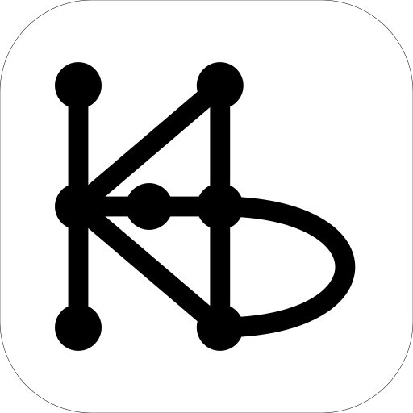
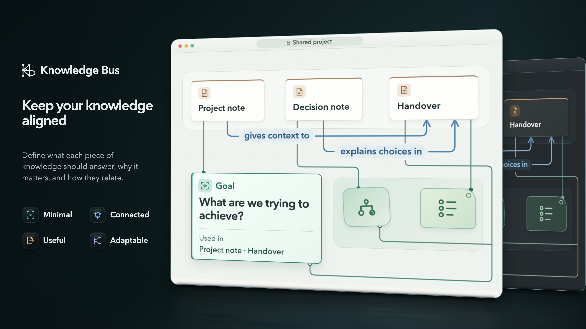

<!-- markdownlint-disable MD033 MD041 -->
<div align="center">

<p>
  <a href="docs/logo/knowledge-bus-mark-black.svg#gh-light-mode-only"></a>
  <a href="docs/logo/knowledge-bus-squircle-light.svg#gh-dark-mode-only"></a>
</p>

# Knowledge Bus

Tools for humans and AI agents to define, structure, and connect knowledge.

[](https://github.com/SterlingJF/knowledge-bus/releases/latest)
[](https://github.com/SterlingJF/knowledge-bus/actions/workflows/ci.yml)
[](LICENSE)

[Docs](https://knowledge-bus.pdflowlabs.io/docs) • [Quickstart](https://knowledge-bus.pdflowlabs.io/docs/quickstart) • [How It Works](https://knowledge-bus.pdflowlabs.io/docs/how-it-works) • [Samples](https://knowledge-bus.pdflowlabs.io/docs/samples/overview) • [Contributing](#contributing)



</div>
<!-- markdownlint-enable MD033 MD041 -->

---

Define the questions your notes and documents need to answer, how their contents connect, and the decisions and actions they should support. Use those expectations to guide new work, review contributions, and exchange knowledge.

Knowledge Bus lets humans and AI agents describe what knowledge means and how it fits together. It gives them a common reference for writing, reading, and using notes and documents.

Read the [documentation](https://knowledge-bus.pdflowlabs.io/docs) for how it works, guides, reference, and the included samples.

## Installation

Requires your agent's CLI and Node.js/npm. Checker-backed skills also require [uv](https://docs.astral.sh/uv/getting-started/installation/) and Python compatible with the [checker package requirement](checker/pyproject.toml).

### Claude Code

In Claude Code chat:

```text
/plugin marketplace add SterlingJF/knowledge-bus
/plugin install knowledge-bus@knowledge-bus
```

Or in your terminal:

```sh
claude plugin marketplace add SterlingJF/knowledge-bus
claude plugin install knowledge-bus@knowledge-bus
```

### Codex

In your terminal:

```sh
codex plugin marketplace add SterlingJF/knowledge-bus
codex plugin add knowledge-bus@knowledge-bus
```

Start a new session after installation.

### Pi

In your terminal:

```sh
pi install npm:@knowledge-bus/pi@latest
```

Run `/reload` in an existing Pi chat to load the skills.

### OpenCode

In your terminal:

```sh
opencode plugin @knowledge-bus/opencode@latest
```

Start a new session after installation. Add `--global` to use it across projects.

### Other Agents or Individual Skills

Choose your agent and skills:

```sh
npx skills add SterlingJF/knowledge-bus
```

Or select a specific skill:

```sh
npx skills add SterlingJF/knowledge-bus --skill kb-check
```

These commands use the default branch, not the latest release. Add `--global` to use the skills across projects. Choose either the plugin or individual skills for each agent to avoid duplicate entries.

[Updates and troubleshooting](https://knowledge-bus.pdflowlabs.io/docs/agent-packages) · [Standalone checker](https://knowledge-bus.pdflowlabs.io/docs/standalone-checker)

## Contributing

See [Contributing](CONTRIBUTING.md) and the [AI Policy](AI_POLICY.md).

## License

MIT.

The code is open source; the Knowledge Bus name and branding are not. Forks should use their own identity and not imply affiliation.
